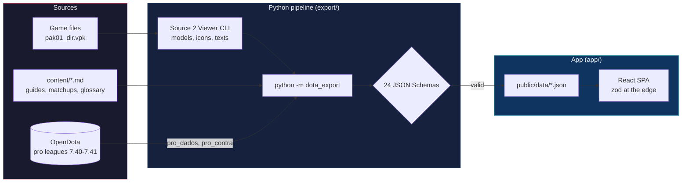
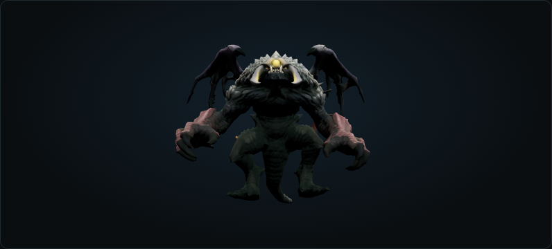
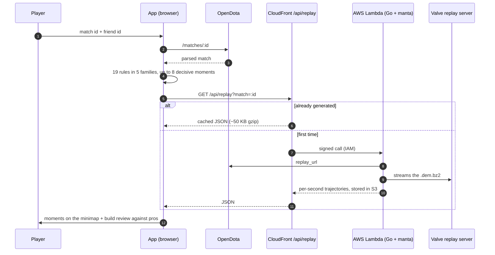
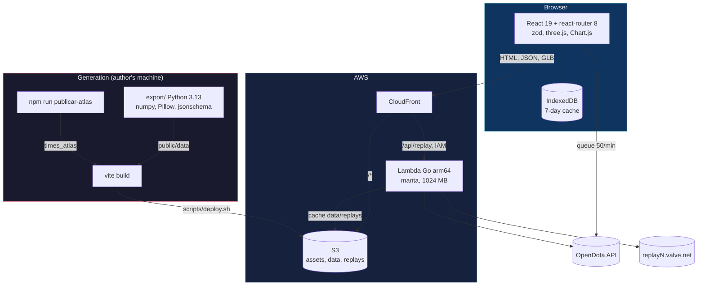

> **[Português](README.md)** | English

<div align="center">

# Dota Hub

**A Dota 2 study hub for patch 7.41 that explains the why behind every route, item and play, backed by pro numbers.**

[](app/package.json)
[](app/package.json)
[](app/package.json)
[](replay/go.mod)
[](export/pyproject.toml)
[](#proof-in-numbers)

**127 1v1 matchups** &bull; **22 guides + 105 per-position sheets** &bull; **12 teams in the Atlas** &bull; **19 post-game rules** &bull; **1,239 tests**

[Open the site](https://d22phpj0gnvpfs.cloudfront.net)

</div>

---

## Table of Contents

- [The problem](#the-problem)
- [Not just another stats site](#not-just-another-stats-site)
- [How it works](#how-it-works)
- [What's inside](#whats-inside)
- [Post-game analysis](#post-game-analysis)
- [Architecture](#architecture)
- [Project structure](#project-structure)
- [Quick Start](#quick-start)
- [Proof in numbers](#proof-in-numbers)
- [Principles](#principles)
- [Configuration](#configuration)
- [License](#license)

---

## The problem

Anyone trying to climb in Dota has too much data and too little explanation. Dotabuff shows that a pro bought Battle Fury at minute 14, but not **why** against that draft, **which route** got them there, or **which play** lost you yesterday's game.

**The insight:** the pro numbers already exist (OpenDota, Valve replays, the game files). What is missing is crossing them with your hero, your enemy and your match, and writing the why next to each one.

**The solution:** a static app that combines the 7.41 map with 872 farm routes, guides with a build timeline and the tactical reason for each item, 1v1 pages with pro builds against each enemy, a draft simulator, an Atlas of tier-1 teams, and a post-game analysis that replays the decisive moments on the minimap from the replay itself.

**The proof:** 159,160 hero appearances in pro league games (7.40 and 7.41) behind the sheets, 1,370 replays from 12 teams parsed for the Atlas, 19 rules tested against a real match, and no content text typed straight into the app: everything comes from `content/` and passes 24 JSON Schemas before it reaches the browser.

---

## Not just another stats site

| | Dotabuff / OpenDota / Stratz | Dota Hub |
|---|---|---|
| **Item build** | Most purchased items for the hero | Timeline with the pros' median minute and the tactical why of each item (22 heroes with their own text) |
| **Matchup** | Win rate against the enemy | 1v1 page with the pro build **against that enemy** and ability answers (127 heroes) |
| **Farming** | Not covered | 3D/2D 7.41 map with 872 drawn routes and the map objectives |
| **Pro teams** | Match list | Atlas of 12 teams: "how to beat", map by side (Radiant, Dire or both), lost lanes |
| **Post-game** | Table of match numbers | Up to 8 decisive moments, a minimap with each hero's real trajectory, and a review of your build against pros in the same draft |
| **Language** | English | Portuguese, with a 355-term glossary |
| **Account** | Login and server-side profile | No login and no backend of its own: the browser talks to OpenDota and caches in IndexedDB |
| **Coverage** | Every patch | Only 7.41, on purpose: less breadth, more depth |

Dotabuff and Stratz win on history and data volume. Dota Hub does not try to compete there; it uses that data to answer "what do I do differently next game".

---

## How it works

All content is generated before deploy by a Python pipeline. Only what changes per match (account, live game, replay) is fetched at runtime.



The app validates everything it reads again with zod, both the generated JSON and the OpenDota responses. If a file does not match its schema, the page shows the error instead of drawing wrong data.

---

## What's inside

The router has 25 entries. The main pages:

| Page | Route | What it does |
|---|---|---|
| Map | `/`, `/mapa/:id` | 7.41 map in 3D (react-three-fiber), falling back to 2D without WebGL; 92 objectives with pins |
| Routes | `/rotas/:id` | 872 farm routes drawn on the map, minute by minute |
| Heroes | `/herois/:id` | Guide with build timeline, the why of each item, game phases and solo Roshan |
| Matchup | `/confronto/:meu/:inimigo` | 1v1 with the pro build against the enemy, timings and answers |
| Draft | `/draft` | Draft simulator with suggestions, lane matchups and a read against an Atlas team |
| Teams | `/times/:id` | Tier-1 Atlas: how to beat, map by side, lost lanes |
| Live | `/ao-vivo/contas/:id`, `/ao-vivo/partidas/:id` | Account and match straight from OpenDota, with a request queue and cache |
| Analysis | `/analise/:matchId` | Post-game: decisive moments, replay minimap and build review |
| Glossary | `/glossario/:id` | 355 terms, with 71 unit sheets and 59 3D models extracted from the game |
| Checklist | `/checklist/:heroi` | Pre- and post-game checklist for the 22 heroes with a full guide |

<details>
<summary><strong>Hero guides: 22 full guides and 105 per-position sheets</strong></summary>

All 127 heroes in 7.41 have a page, on two levels:

- **22 full guides** (`content/porque_itens/`): build with the pros' median and p25 minute, and one paragraph per item explaining the tactical reason. Example: the first Battle Fury component on Juggernaut "is not an item to sell later".
- **105 per-position sheets** (`content/fichas/`): when to pick, the most played position in the pro sample, core and situational items.

The numbers come from `content/pro_dados/` (159,160 hero appearances in pro league games on patches 7.40 and 7.41, queried through the OpenDota explorer).

</details>

<details>
<summary><strong>1v1 matchups: 127 heroes with pro builds per enemy</strong></summary>

Each matchup page crosses three sources:

| Source | File | What it brings |
|---|---|---|
| Matchup text | `content/confrontos/<hero>.md` | How to play against, ability interactions |
| General pro data | `content/pro_dados/<hero>.json` | GPM, XPM, LH at 10, items with median |
| Build per enemy | `content/pro_contra/<hero>.json` | The hero's purchase log **against each enemy**, 18 months of pro leagues |

`pro_contra` adds up to 1,836,185 hero-versus-enemy pairs. The page shows the items pros finish against that specific enemy, with the median minute and the number of games, and flags small samples.

</details>

<details>
<summary><strong>Tier-1 Atlas: 12 teams, from 2026-03-24 to 2026-10-06</strong></summary>

| Team | Matches | Replays parsed | Style |
|---|---|---|---|
| Team Spirit | 122 | 121 | Contact |
| Team Yandex | 112 | 112 | Projection |
| PARIVISION | 124 | 124 | Projection |
| BetBoom Team | 130 | 130 | Home and farm |
| Aurora Gaming | 134 | 133 | Contact |
| Team Falcons | 116 | 116 | Home and farm |
| Team Liquid | 129 | 128 | Contact |
| 1win | 142 | 140 | Contact |
| LGD Gaming (frontier) | 108 | 107 | Home and farm |
| Nigma Galaxy | 72 | 71 | Contact |
| Natus Vincere | 76 | 76 | Home and farm |
| Xtreme Gaming (frontier) | 112 | 112 | Home and farm |

In total: 1,377 team matches and 1,370 replays parsed (a game between two Atlas teams counts for both). Each team has a "how to beat" card at the top, the map by side (Radiant, Dire or both together) and the lanes it loses most. The Atlas is published with `npm run publicar-atlas`, which validates every file with the app's zod schemas and logs each format fix to `registro.txt`.

</details>

<details>
<summary><strong>Live: account and match from OpenDota, no backend</strong></summary>

The live pages call the public OpenDota API straight from the browser:

- **Queue** (`app/src/live/fila.ts`): at most 50 calls per minute, 200 ms apart, and a 15 s maximum wait before failing with the time left.
- **Cache** (`app/src/live/cache.ts`): IndexedDB with a 7-day maximum retention; the page shows when data is stale.
- **Validation**: every response goes through zod; a test guarantees no URL leaves with `api_key=`.

</details>

<p align="center">
  
  <br><sub>Roshan, one of the 59 3D models extracted from the game for the unit glossary.</sub>
</p>

---

## Post-game analysis

You paste the match id and your friend id. The app fetches the match from OpenDota, runs 19 rules and picks up to 8 moments that weighed most on the result.



<details>
<summary><strong>The 19 rules, by family</strong></summary>

| Family | Rules | Examples |
|---|---|---|
| `build` | 5 | item against the enemies, late core, big item with gold in pocket, item out of context |
| `economia-e-lutas` | 5 | last hits against reference, lane against the opponent, GPM against pros, deaths at a disadvantage |
| `mortes-e-visao` | 4 | death map, repeated deaths, deaths while farming, wards placed |
| `objetivos-e-aegis` | 4 | deaths with enemy Aegis active, Roshan count, buyback in the Roshan window, tower lost after death |
| `momentos` | 1 | death while outnumbered, using respawn of all 10 heroes, towers and Aegis |

Each rule lives in its own file under `app/src/analise/regras/<family>/`, and families are registered through `import.meta.glob`. Adding a rule means creating a file and listing it in the family's `index.ts`.

</details>

<details>
<summary><strong>The replay minimap</strong></summary>

The Go reader (`replay/trajetos`) uses [manta](https://github.com/dotabuff/manta) v1.5.1 and returns, per second, each hero's position, deaths, wards, smokes, towers, levels and last hits per minute. Validated against OpenDota on match 9046905170:

- same duration and all 14 towers with exact name and time;
- the 93 kills in `kills_log` with the same killer and victim within 1 s;
- 47 observers and 72 sentries equal to `obs_placed` and `sen_placed`;
- last hits off by at most 5 over 51 minutes.

A 50-minute game yields ~185 KB of JSON and ~49 KB gzipped. The service is an AWS Lambda behind CloudFront (`/api/replay`): it only accepts digit-only ids, only downloads from `replayN.valve.net`, stores the result in S3, and CloudFront caches the 200 for a year. The first generation takes 6 to 10 s; later ones ~30 ms.

</details>

<details>
<summary><strong>Build review</strong></summary>

`app/src/analise/suaBuild.ts` compares what you bought, and when, with the pro build **against the same enemy team** (data from `pro_contra`). Each verdict carries the minute, the weight and, when available, the tactical why of the item taken from the 22 guides.

</details>

---

## Architecture

The site is static. The only server code is the replay Lambda.



| Layer | Stack | Size |
|---|---|---|
| App | React 19, Vite 8, TypeScript 6, zod 4, react-three-fiber 9, Chart.js 4, MiniSearch | 16,409 lines of TS outside tests |
| Export | Python 3.13, numpy, Pillow, matplotlib, jsonschema | 2,657 lines, 24 schemas |
| Replay | Go 1.26, manta 1.5.1, aws-sdk-go-v2 | 1,376 lines |
| Infra | S3 + CloudFront + Lambda (us-east-2) | scripts `app/scripts/deploy.sh` and `replay/infra.sh` |

---

## Project structure

```
dota-hub/
├── app/                      # React + Vite SPA
│   ├── src/
│   │   ├── map/              # 3D/2D map, routes, objectives
│   │   ├── heroes/           # guides and per-position sheets
│   │   ├── confronto/        # 1v1 pages and pro builds per enemy
│   │   ├── draft/            # draft simulator
│   │   ├── times/            # tier-1 Atlas
│   │   ├── live/             # OpenDota account and match (queue, cache, zod)
│   │   ├── analise/          # post-game: engine, 19 rules, decisive moments
│   │   │   └── regras/       # one folder per family, one rule per file
│   │   ├── replay/           # reads trajectories from /api/replay
│   │   ├── unidades/         # unit sheets and 3D scene
│   │   └── glossary/         # glossary and search
│   ├── scripts/              # deploy, publicar-atlas, posters
│   └── plugins/              # Vite plugin that builds a local replay in dev
├── export/                   # Python pipeline that generates app/public/data
│   ├── dota_export/          # one module per data type
│   ├── schemas/              # 24 JSON Schemas
│   └── tests/                # 243 pytest tests
├── replay/                   # Go replay reader + Lambda
│   ├── trajetos/             # parser built on manta
│   ├── cmd/trajetos/         # local CLI
│   ├── cmd/lambda/           # /api/replay handler
│   └── infra.sh              # creates/updates the Lambda and the CloudFront route
├── content/                  # all site text, in Markdown and JSON
│   ├── confrontos/           # 127 matchups
│   ├── fichas/               # 105 per-position sheets
│   ├── porque_itens/         # 22 guides with the why of each item
│   ├── pro_dados/            # 127 pro summaries
│   ├── pro_contra/           # 127 pro builds per enemy
│   └── glossario/            # 355 terms
└── docs/                     # specs, plans, audits and analysis validation
```

---

## Quick Start

**Prerequisites:** Node 22+ and npm. For the data pipeline: Python 3.13, Windows and Dota 2 installed. For the replay reader: Go 1.26.

`app/public/data` is not in git (103 MB generated). It comes from `python -m dota_export`, which reads the installed Dota 2 files, uses the Source 2 Viewer CLI downloaded into `export/ferramentas`, and imports analysis projects that live outside this repository. So the practical way to run it locally is to use the data already published on the site:

```bash
git clone https://github.com/Felipeness/dota-hub.git
cd dota-hub/app
npm ci
DOTA_DADOS_PUBLICADOS=1 npm run dev
```

In PowerShell, the last line is `$env:DOTA_DADOS_PUBLICADOS=1; npm run dev`. Open `http://localhost:5173`: Vite forwards `/data/*` and `/api/replay` to the live site, and every page works with the 7.41 data.

<details>
<summary><strong>Running the tests</strong></summary>

```bash
cd app && npm test          # vitest, 974 tests in 132 files
cd replay && go test ./...  # 22 tests
cd export && pip install -e .[dev] && python -m pytest -q   # 243 tests
```

To be honest about what runs on a clean clone:

| Suite | With generated data | Clean clone |
|---|---|---|
| vitest | 974 of 974 | 861 pass; 14 files fail because they read `public/data` |
| Go | 22 of 22 | 22 of 22 |
| pytest | 243 of 243 | 110 pass; the rest read analysis projects outside the repo |

</details>

<details>
<summary><strong>Generating the data from scratch (author's machine)</strong></summary>

```bash
pip install -e export[dev]
cd export
python -m dota_export.ferramentas   # downloads Source 2 Viewer CLI 20.0 and checks its SHA-256
python -m dota_export               # generates app/public/data (needs Dota 2 and the analysis projects)
python -m dota_export --rotas       # routes, summary and index only; no game needed
cd ../app && npm run publicar-atlas # copies and validates the tier-1 Atlas
```

Dota 2 is looked up in `C:\Program Files (x86)\Steam` and the other Steam libraries. The analysis projects (farm GPS, pro replays, player panels) are read from `~/Desktop`, read-only.

</details>

<details>
<summary><strong>Generating a replay trajectory locally</strong></summary>

```bash
cd replay
go run ./cmd/trajetos -replay 9046905170.dem.bz2 -match 9046905170 -out 9046905170.json.gz
```

</details>

---

## Proof in numbers

Everything below was measured in the repository, not estimated.

| Metric | Value | How to measure |
|---|---|---|
| vitest tests | 974 in 132 files | `cd app && npx vitest run` |
| pytest tests | 243 | `cd export && python -m pytest -q` |
| Go tests | 22 | `cd replay && go test -v ./...` |
| Heroes with a matchup page | 127 | `content/confrontos/` |
| Full guides / per-position sheets | 22 / 105 | `content/porque_itens/`, `content/fichas/` |
| Teams in the Atlas | 12 (10 tier 1 + 2 frontier) | `times_atlas/indice.json` |
| Pro replays parsed for the Atlas | 1,370 | sum of `replays` in the index |
| Hero appearances in pro leagues | 159,160 | sum of `resumo.n` in `content/pro_dados/` |
| Post-game rules | 19 in 5 families | `app/src/analise/regras/*/index.ts` |
| Router entries | 25 | `app/src/App.tsx` |
| Farm routes | 872 | `meta.json` |
| Glossary terms | 355 | `content/glossario/` |
| 3D models | 59 `.glb` | `public/data/modelos/` |
| JSON Schemas | 24 | `export/schemas/` |

---

## Principles

**Nothing typed by hand in the app.** All content text lives in `content/` and goes through the pipeline. React components only draw; if a number is wrong, the error is in the source and gets fixed there.

**Validate at the edge, trust inside.** The export validates with JSON Schema before writing; the app validates with zod before using. An OpenDota response that does not match the schema becomes an error message, not a broken page.

**Numbers with a source.** Every sheet states where it came from (OpenDota explorer, replay, game file), the sample size, and when the sample is too small to conclude anything.

**One patch, deep.** The hub covers only 7.41. When the patch changes, the content is redone instead of piling up versions.

---

## Configuration

<details>
<summary><strong>Environment variables</strong></summary>

**Dev server (`app/vite.config.ts`)**

| Variable | Default | Purpose |
|---|---|---|
| `DOTA_DADOS_PUBLICADOS` | off | `1` forwards `/data/*` to the live site instead of reading `public/data` |
| `DOTA_REPLAY_LEITOR` | `../../dota-tier1/tools/replay/replay.exe` | replay reader used by the `replayLocal` plugin in dev |
| `DOTA_REPLAYS` | `D:/dota-replays/hub` | folder where the plugin stores downloaded replays |

**Lambda (`replay/cmd/lambda`)**

| Variable | Purpose |
|---|---|
| `BUCKET` | S3 bucket holding `data/replays/<id>.json` |

**`replay/infra.sh`**

| Variable | Default | Purpose |
|---|---|---|
| `MEMORY_MB` | `1024` | Lambda memory |
| `BACKUP_DIR` | temp folder | where to save the CloudFront config before editing it |

</details>

<details>
<summary><strong>/api/replay errors</strong></summary>

| Status | `code` | When |
|---|---|---|
| 400 | `match_invalido` | `match` is not digits only |
| 404 | `replay_indisponivel` | Valve already deleted the replay or OpenDota lacks the salt |
| 502 | `upstream` | OpenDota, Valve or S3 failed |
| 500 | `interno` | unexpected error |

The body is always `{ "code": "...", "message": "..." }`. Errors are not cached (`no-store`).

</details>

---

## License

This repository has no license yet. Until one is chosen, all rights are reserved by the author.

Dota 2 is a trademark of Valve Corporation. The models, icons and texts extracted from the game belong to Valve. Match data comes from the public [OpenDota](https://www.opendota.com) API, and replays are read with Dotabuff's [manta](https://github.com/dotabuff/manta).
