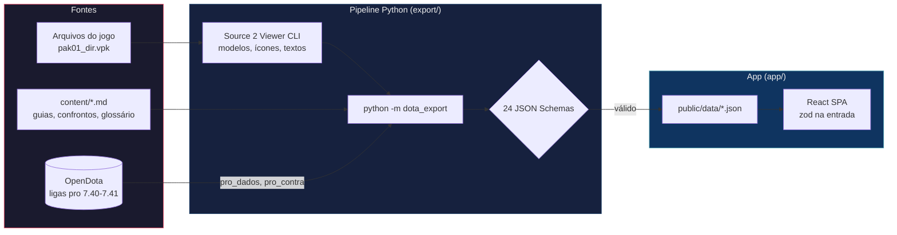
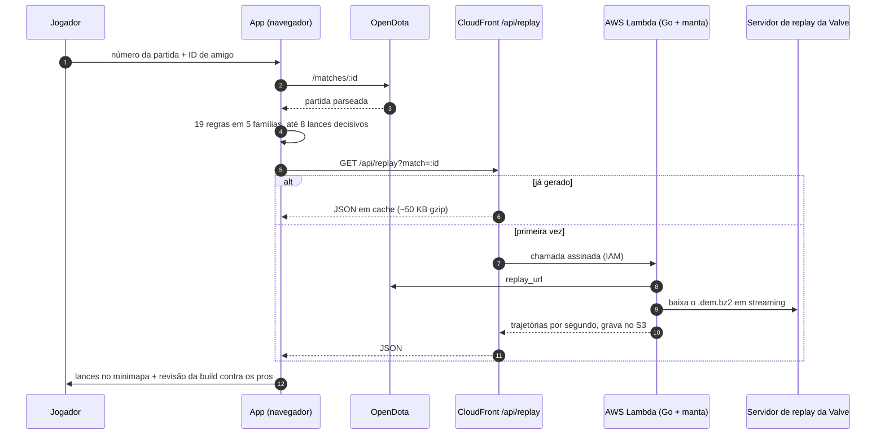
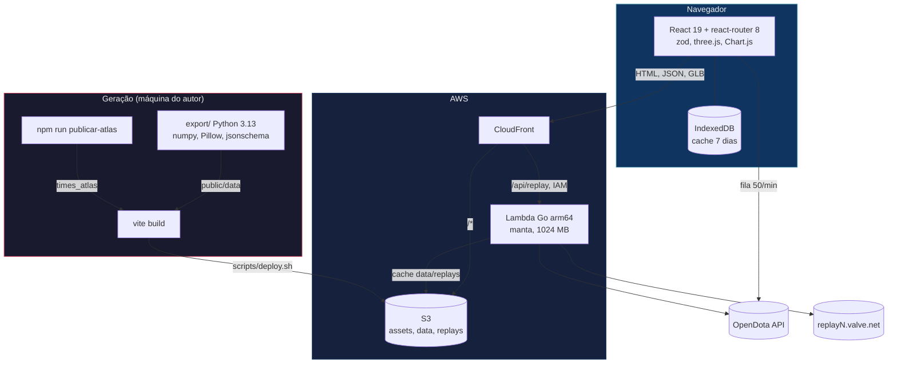

> Português | **[English](README.en.md)**

<div align="center">

# Dota Hub

**Um hub de estudo de Dota 2 no patch 7.41 que explica o porquê de cada rota, item e lance, com número de pro por trás.**

[](app/package.json)
[](app/package.json)
[](app/package.json)
[](replay/go.mod)
[](export/pyproject.toml)
[](#a-prova-em-números)

**127 confrontos 1x1** &bull; **22 guias + 105 fichas por posição** &bull; **12 times no Atlas** &bull; **19 regras de pós-jogo** &bull; **1.239 testes**

[Abrir o site](https://d22phpj0gnvpfs.cloudfront.net)

</div>

---

## Sumário

- [O problema](#o-problema)
- [Não é só mais um site de estatística](#não-é-só-mais-um-site-de-estatística)
- [Como funciona](#como-funciona)
- [O que tem dentro](#o-que-tem-dentro)
- [Análise de pós-jogo](#análise-de-pós-jogo)
- [Arquitetura](#arquitetura)
- [Estrutura do projeto](#estrutura-do-projeto)
- [Quick Start](#quick-start)
- [A prova em números](#a-prova-em-números)
- [Princípios](#princípios)
- [Configuração](#configuração)
- [Licença](#licença)

---

## O problema

Quem quer subir de rank no Dota tem dado demais e explicação de menos. O Dotabuff mostra que o pro comprou Battle Fury aos 14 minutos, mas não diz **por que** contra aquele draft, **qual rota** ele fez até lá, nem **qual lance** fez você perder a sua partida de ontem.

**A sacada:** os números de pro já existem (OpenDota, replays da Valve, arquivos do jogo). O que falta é cruzar esses números com o seu herói, o seu inimigo e a sua partida, e escrever o porquê ao lado de cada um.

**A solução:** um app estático que junta o mapa do 7.41 com 872 rotas de farm, guias com a linha do tempo da build e o motivo tático de cada item, páginas 1x1 com a build dos pros contra cada inimigo, um simulador de draft, um Atlas dos times tier 1 e uma análise de pós-jogo que reproduz os lances decisivos no minimapa a partir do replay.

**A prova:** 159.160 aparições de herói em ligas pro (7.40 e 7.41) por trás das fichas, 1.370 replays de 12 times lidos para o Atlas, 19 regras com teste contra uma partida real, e nenhum texto de conteúdo digitado direto no app: tudo sai de `content/` e passa por 24 JSON Schemas antes de chegar ao navegador.

---

## Não é só mais um site de estatística

| | Dotabuff / OpenDota / Stratz | Dota Hub |
|---|---|---|
| **Build de item** | Itens mais comprados pelo herói | Linha do tempo com minuto mediano dos pros e o porquê tático de cada item (22 heróis com texto próprio) |
| **Matchup** | Win rate contra o inimigo | Página 1x1 com a build dos pros **contra aquele inimigo** e respostas de habilidade (127 heróis) |
| **Farm** | Não tem | Mapa 3D/2D do 7.41 com 872 rotas desenhadas e os objetivos do mapa |
| **Times pro** | Lista de partidas | Atlas de 12 times: "como vencer", mapa por lado (Radiant, Dire ou os dois), lanes perdidas |
| **Pós-jogo** | Tabela de números da partida | Até 8 lances decisivos, minimapa com a trajetória real de cada herói e revisão da sua build contra os pros no mesmo draft |
| **Idioma** | Inglês | Português, com glossário de 355 termos |
| **Conta** | Login e perfil no servidor | Sem login e sem backend próprio: o navegador fala com o OpenDota e guarda o cache no IndexedDB |
| **Cobertura** | Todos os patches | Só o 7.41, de propósito: menos coisa, mais profundidade |

O Dotabuff e o Stratz ganham em histórico e volume de dados. O Dota Hub não tenta competir nisso; ele usa esses dados para responder "o que eu faço diferente na próxima".

---

## Como funciona

Tudo que é conteúdo é gerado antes do deploy por um pipeline em Python. Só o que muda a cada partida (conta, jogo ao vivo, replay) é buscado na hora.



O app valida de novo com zod tudo que lê, tanto o JSON gerado quanto as respostas do OpenDota. Se um arquivo não bate com o schema, a tela mostra o erro em vez de desenhar dado errado.

---

## O que tem dentro

O router tem 25 entradas. As principais telas:

| Tela | Rota | O que faz |
|---|---|---|
| Mapa | `/`, `/mapa/:id` | Mapa do 7.41 em 3D (react-three-fiber) com queda para 2D sem WebGL; 92 objetivos com pinos |
| Rotas | `/rotas/:id` | 872 rotas de farm desenhadas no mapa, com minuto a minuto |
| Heróis | `/herois/:id` | Guia com linha do tempo da build, porquê de cada item, fases do jogo e solo de Roshan |
| Confronto | `/confronto/:meu/:inimigo` | 1x1 com build dos pros contra o inimigo, timings e respostas |
| Draft | `/draft` | Simulador de draft com sugestões, confrontos de lane e leitura contra time do Atlas |
| Times | `/times/:id` | Atlas tier 1: como vencer, mapa por lado, lanes perdidas |
| Ao vivo | `/ao-vivo/contas/:id`, `/ao-vivo/partidas/:id` | Conta e partida direto do OpenDota, com fila de requisições e cache |
| Análise | `/analise/:matchId` | Pós-jogo: lances decisivos, minimapa do replay e revisão da build |
| Glossário | `/glossario/:id` | 355 termos, com 71 fichas de unidade e 59 modelos 3D extraídos do jogo |
| Checklist | `/checklist/:heroi` | Checklist de pré e pós-jogo para os 22 heróis com guia completo |

<details>
<summary><strong>Guias de herói: 22 completos e 105 fichas por posição</strong></summary>

Os 127 heróis do 7.41 têm página. São dois níveis:

- **22 guias completos** (`content/porque_itens/`): build com minuto mediano e p25 dos pros, e um parágrafo por item explicando o motivo tático. Exemplo: o primeiro componente do Battle Fury do Juggernaut "não é item pra vender depois".
- **105 fichas por posição** (`content/fichas/`): quando pegar, posição mais usada no recorte pro, itens core e situacionais.

Os números vêm de `content/pro_dados/` (159.160 aparições de herói em ligas pro dos patches 7.40 e 7.41, consultadas no explorer do OpenDota).

</details>

<details>
<summary><strong>Confrontos 1x1: 127 heróis com a build dos pros por inimigo</strong></summary>

Cada página de confronto cruza três fontes:

| Fonte | Arquivo | O que traz |
|---|---|---|
| Texto do confronto | `content/confrontos/<heroi>.md` | Como jogar contra, interações de habilidade |
| Dados gerais de pro | `content/pro_dados/<heroi>.json` | GPM, XPM, LH aos 10, itens com mediana |
| Build por inimigo | `content/pro_contra/<heroi>.json` | Purchase log do herói **contra cada inimigo**, 18 meses de ligas pro |

O `pro_contra` soma 1.836.185 pares herói contra inimigo. A tela mostra os itens que os pros fecham contra aquele inimigo específico, com a mediana de minuto e o número de jogos, e marca quando a amostra é pequena.

</details>

<details>
<summary><strong>Atlas tier 1: 12 times, de 24/03 a 06/10/2026</strong></summary>

| Time | Partidas | Replays lidos | Estilo |
|---|---|---|---|
| Team Spirit | 122 | 121 | Contato |
| Team Yandex | 112 | 112 | Projeção |
| PARIVISION | 124 | 124 | Projeção |
| BetBoom Team | 130 | 130 | Casa e farm |
| Aurora Gaming | 134 | 133 | Contato |
| Team Falcons | 116 | 116 | Casa e farm |
| Team Liquid | 129 | 128 | Contato |
| 1win | 142 | 140 | Contato |
| LGD Gaming (fronteira) | 108 | 107 | Casa e farm |
| Nigma Galaxy | 72 | 71 | Contato |
| Natus Vincere | 76 | 76 | Casa e farm |
| Xtreme Gaming (fronteira) | 112 | 112 | Casa e farm |

Somando: 1.377 partidas de time e 1.370 replays lidos (um jogo entre dois times do Atlas conta para os dois). Cada time tem o card "como vencer" no topo, o mapa por lado (Radiant, Dire ou os dois juntos) e as lanes que ele mais perde. O Atlas é publicado com `npm run publicar-atlas`, que valida cada arquivo com os schemas zod do app e registra toda correção de formato em `registro.txt`.

</details>

<details>
<summary><strong>Ao vivo: conta e partida pelo OpenDota, sem backend</strong></summary>

As telas ao vivo chamam a API pública do OpenDota direto do navegador:

- **Fila** (`app/src/live/fila.ts`): no máximo 50 chamadas por minuto, 200 ms entre elas e espera máxima de 15 s antes de falhar com o tempo que falta.
- **Cache** (`app/src/live/cache.ts`): IndexedDB com guarda máxima de 7 dias; a tela mostra quando o dado está vencido.
- **Validação**: toda resposta passa por zod; um teste garante que nenhuma URL sai com `api_key=`.

</details>

<p align="center">
  
  <br><sub>Roshan, um dos 59 modelos 3D extraídos do jogo para o glossário de unidades.</sub>
</p>

---

## Análise de pós-jogo

Você cola o número da partida e o seu ID de amigo. O app busca a partida no OpenDota, roda 19 regras e escolhe até 8 lances que mais pesaram no resultado.



<details>
<summary><strong>As 19 regras, por família</strong></summary>

| Família | Regras | Exemplos |
|---|---|---|
| `build` | 5 | item contra os inimigos, core atrasado, item grande com ouro no bolso, item fora de contexto |
| `economia-e-lutas` | 5 | last hits contra referência, lane contra o adversário, GPM contra pro, mortes em desvantagem |
| `mortes-e-visao` | 4 | mapa de mortes, mortes repetidas, mortes no farm, wards colocadas |
| `objetivos-e-aegis` | 4 | mortes com Aegis inimiga ativa, contagem de Roshan, buyback na janela do Roshan, torre perdida após morte |
| `momentos` | 1 | morte em inferioridade numérica, com respawn dos 10 heróis, torres e Aegis |

Cada regra mora num arquivo próprio em `app/src/analise/regras/<familia>/`, e as famílias são registradas por `import.meta.glob`. Adicionar uma regra é criar um arquivo e colocá-lo no `index.ts` da família.

</details>

<details>
<summary><strong>O minimapa do replay</strong></summary>

O leitor em Go (`replay/trajetos`) usa o [manta](https://github.com/dotabuff/manta) v1.5.1 e devolve, por segundo, a posição de cada herói, mortes, wards, smokes, torres, níveis e last hits por minuto. Validado contra o OpenDota na partida 9046905170:

- duração igual e as 14 torres com nome e tempo exatos;
- os 93 kills do `kills_log` com mesmo assassino e vítima dentro de 1 s;
- 47 observers e 72 sentries iguais ao `obs_placed` e `sen_placed`;
- last hits com diferença máxima de 5 em 51 minutos.

Uma partida de 50 minutos dá ~185 KB de JSON e ~49 KB em gzip. O serviço é uma AWS Lambda atrás do CloudFront (`/api/replay`): só aceita ID com dígitos, só baixa de `replayN.valve.net`, guarda o resultado no S3 e o CloudFront guarda o 200 por um ano. A primeira geração leva de 6 a 10 s; as seguintes, ~30 ms.

</details>

<details>
<summary><strong>Revisão da build</strong></summary>

`app/src/analise/suaBuild.ts` compara o que você comprou, e quando, com a build dos pros **contra o mesmo time inimigo** (dados de `pro_contra`). Cada veredito traz o minuto, o peso e, quando existe, o porquê tático do item tirado dos 22 guias.

</details>

---

## Arquitetura

O site é estático. O único código de servidor é a Lambda de replay.



| Camada | Stack | Tamanho |
|---|---|---|
| App | React 19, Vite 8, TypeScript 6, zod 4, react-three-fiber 9, Chart.js 4, MiniSearch | 16.409 linhas de TS fora dos testes |
| Export | Python 3.13, numpy, Pillow, matplotlib, jsonschema | 2.657 linhas, 24 schemas |
| Replay | Go 1.26, manta 1.5.1, aws-sdk-go-v2 | 1.376 linhas |
| Infra | S3 + CloudFront + Lambda (us-east-2) | scripts `app/scripts/deploy.sh` e `replay/infra.sh` |

---

## Estrutura do projeto

```
dota-hub/
├── app/                      # SPA React + Vite
│   ├── src/
│   │   ├── map/              # mapa 3D/2D, rotas, objetivos
│   │   ├── heroes/           # guias e fichas por posição
│   │   ├── confronto/        # páginas 1x1 e build dos pros por inimigo
│   │   ├── draft/            # simulador de draft
│   │   ├── times/            # Atlas tier 1
│   │   ├── live/             # conta e partida do OpenDota (fila, cache, zod)
│   │   ├── analise/          # pós-jogo: motor, 19 regras, lances decisivos
│   │   │   └── regras/       # uma pasta por família, uma regra por arquivo
│   │   ├── replay/           # leitura das trajetórias do /api/replay
│   │   ├── unidades/         # fichas e cena 3D das unidades
│   │   └── glossary/         # glossário e busca
│   ├── scripts/              # deploy, publicar-atlas, posters
│   └── plugins/              # plugin do Vite que gera replay local no dev
├── export/                   # pipeline Python que gera app/public/data
│   ├── dota_export/          # um módulo por tipo de dado
│   ├── schemas/              # 24 JSON Schemas
│   └── tests/                # 243 testes pytest
├── replay/                   # leitor de replay em Go + Lambda
│   ├── trajetos/             # parser com manta
│   ├── cmd/trajetos/         # CLI local
│   ├── cmd/lambda/           # handler do /api/replay
│   └── infra.sh              # cria/atualiza Lambda e rota no CloudFront
├── content/                  # todo o texto do site, em Markdown e JSON
│   ├── confrontos/           # 127 confrontos
│   ├── fichas/               # 105 fichas por posição
│   ├── porque_itens/         # 22 guias com o porquê de cada item
│   ├── pro_dados/            # 127 resumos de pro
│   ├── pro_contra/           # 127 builds de pro por inimigo
│   └── glossario/            # 355 termos
└── docs/                     # specs, planos, auditorias e validação da análise
```

---

## Quick Start

**Pré-requisitos:** Node 22+ e npm. Para o pipeline de dados: Python 3.13, Windows e o Dota 2 instalado. Para o replay: Go 1.26.

O `app/public/data` não está no git (103 MB gerados). Ele sai de `python -m dota_export`, que lê os arquivos do Dota 2 instalado, usa o Source 2 Viewer CLI baixado para `export/ferramentas` e importa projetos de análise que ficam fora deste repositório. Então o caminho prático para rodar localmente é usar os dados que já estão publicados no site:

```bash
git clone https://github.com/Felipeness/dota-hub.git
cd dota-hub/app
npm ci
DOTA_DADOS_PUBLICADOS=1 npm run dev
```

No PowerShell, a última linha é `$env:DOTA_DADOS_PUBLICADOS=1; npm run dev`. Abra `http://localhost:5173`: o Vite repassa `/data/*` e `/api/replay` para o site no ar, e todas as telas funcionam com os dados do 7.41.

<details>
<summary><strong>Rodar os testes</strong></summary>

```bash
cd app && npm test          # vitest, 974 testes em 132 arquivos
cd replay && go test ./...  # 22 testes
cd export && pip install -e .[dev] && python -m pytest -q   # 243 testes
```

Sendo honesto sobre o que roda num clone limpo:

| Suíte | Com os dados gerados | Clone limpo |
|---|---|---|
| vitest | 974 de 974 | 861 passam; 14 arquivos falham porque leem `public/data` |
| Go | 22 de 22 | 22 de 22 |
| pytest | 243 de 243 | 110 passam; o resto lê os projetos de análise fora do repo |

</details>

<details>
<summary><strong>Gerar os dados do zero (máquina do autor)</strong></summary>

```bash
pip install -e export[dev]
cd export
python -m dota_export.ferramentas   # baixa o Source 2 Viewer CLI 20.0 e confere o SHA-256
python -m dota_export               # gera app/public/data (precisa do Dota 2 e dos projetos de análise)
python -m dota_export --rotas       # só rotas, resumo e índice; não precisa do jogo
cd ../app && npm run publicar-atlas # copia e valida o Atlas tier 1
```

O Dota 2 é procurado em `C:\Program Files (x86)\Steam` e nas outras bibliotecas da Steam. Os projetos de análise (GPS de farm, replays de pro, painéis de jogador) são lidos de `~/Desktop`, em modo só leitura.

</details>

<details>
<summary><strong>Gerar a trajetória de um replay localmente</strong></summary>

```bash
cd replay
go run ./cmd/trajetos -replay 9046905170.dem.bz2 -match 9046905170 -out 9046905170.json.gz
```

</details>

---

## A prova em números

Tudo abaixo foi medido no repositório, não estimado.

| Métrica | Valor | Como medir |
|---|---|---|
| Testes vitest | 974 em 132 arquivos | `cd app && npx vitest run` |
| Testes pytest | 243 | `cd export && python -m pytest -q` |
| Testes Go | 22 | `cd replay && go test -v ./...` |
| Heróis com confronto | 127 | `content/confrontos/` |
| Guias completos / fichas por posição | 22 / 105 | `content/porque_itens/`, `content/fichas/` |
| Times no Atlas | 12 (10 tier 1 + 2 fronteira) | `times_atlas/indice.json` |
| Replays de pro lidos para o Atlas | 1.370 | soma de `replays` no índice |
| Aparições de herói em ligas pro | 159.160 | soma de `resumo.n` em `content/pro_dados/` |
| Regras de pós-jogo | 19 em 5 famílias | `app/src/analise/regras/*/index.ts` |
| Entradas no router | 25 | `app/src/App.tsx` |
| Rotas de farm | 872 | `meta.json` |
| Termos no glossário | 355 | `content/glossario/` |
| Modelos 3D | 59 `.glb` | `public/data/modelos/` |
| JSON Schemas | 24 | `export/schemas/` |

---

## Princípios

**Nada digitado à mão no app.** Todo texto de conteúdo mora em `content/` e passa pelo pipeline. O componente React só desenha; se um número está errado, o erro está na fonte e é corrigido lá.

**Validar na borda, confiar dentro.** O export valida com JSON Schema antes de gravar; o app valida com zod antes de usar. Resposta do OpenDota que não bate com o schema vira mensagem de erro, não tela quebrada.

**Número com fonte.** Cada ficha diz de onde veio (OpenDota explorer, replay, arquivo do jogo), o tamanho da amostra e quando ela é pequena demais para concluir algo.

**Um patch, fundo.** O hub cobre só o 7.41. Quando o patch muda, o conteúdo é refeito em vez de acumular versões.

---

## Configuração

<details>
<summary><strong>Variáveis de ambiente</strong></summary>

**Dev server (`app/vite.config.ts`)**

| Variável | Padrão | Para quê |
|---|---|---|
| `DOTA_DADOS_PUBLICADOS` | desligado | `1` repassa `/data/*` para o site no ar em vez de ler `public/data` |
| `DOTA_REPLAY_LEITOR` | `../../dota-tier1/tools/replay/replay.exe` | leitor de replay usado pelo plugin `replayLocal` no dev |
| `DOTA_REPLAYS` | `D:/dota-replays/hub` | pasta onde o plugin guarda os replays baixados |

**Lambda (`replay/cmd/lambda`)**

| Variável | Para quê |
|---|---|
| `BUCKET` | bucket S3 onde ficam `data/replays/<id>.json` |

**`replay/infra.sh`**

| Variável | Padrão | Para quê |
|---|---|---|
| `MEMORY_MB` | `1024` | memória da Lambda |
| `BACKUP_DIR` | pasta temporária | onde salvar a config do CloudFront antes de editar |

</details>

<details>
<summary><strong>Erros do /api/replay</strong></summary>

| Status | `code` | Quando |
|---|---|---|
| 400 | `match_invalido` | `match` não é só dígitos |
| 404 | `replay_indisponivel` | a Valve já apagou o replay ou o OpenDota não tem o salt |
| 502 | `upstream` | OpenDota, Valve ou S3 falhou |
| 500 | `interno` | erro inesperado |

O corpo é sempre `{ "code": "...", "message": "..." }`. Erros não ficam em cache (`no-store`).

</details>

---

## Licença

Ainda não há licença definida neste repositório. Até lá, todos os direitos são reservados ao autor.

Dota 2 é marca da Valve Corporation. Os modelos, ícones e textos extraídos do jogo pertencem à Valve. Os dados de partida vêm da API pública do [OpenDota](https://www.opendota.com) e os replays são lidos com o [manta](https://github.com/dotabuff/manta), do Dotabuff.
